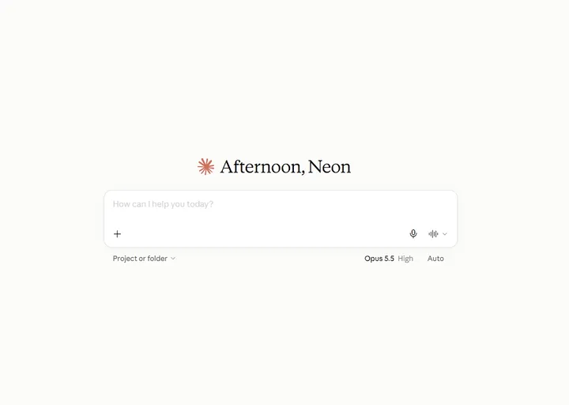

# Nilo 开源视频网站

## 介绍

欢迎来到 Nilo 开源视频网站的前端仓库！

> 因成本限制，目前 Nilo 仅在 (UTC+0) 23:00 ~ 次日 11:00 提供服务（ UTC+8 : 7:00 ~ 19:00 ）

[介绍页](https://www.nilo.video/about) - 介绍 Nilo  
[首页](https://www.nilo.video/) - 抢先体验  

    

[后端仓库](https://github.com/avaNeon/nilo-server) - 了解 Nilo 的后端

## 新功能

1. 在主页顶部搜索栏右侧点击“AI 搜索”，在展开的聊天框中输入你想提问的内容：

2. 在视频页面中，向侧边栏的 **AI 视频助手** 提问某个片段来源于哪个时间点：

3. 上传的视频会自动抽出音频并转换成文本。对于大多数 BGM 并不嘈杂的视频，都可以成功生成字幕。除此之外我们还提供：
   - 字幕自动翻译为中文
   - 自动根据字幕总结视频片段

4. 如果你想远程使用本网站的搜索工具，可以让你的 Agent 连接到本网站的 MCP 服务器来搜索本网站的视频（具体使用方式见下文）：

> 想停下来仔细查看动图中的输出？可以观看演示视频：[AI-MCP.mp4](docs/agent/AI-MCP.mp4)

## 文档

| 文档                             | 内容                                    |
| -------------------------------- | --------------------------------------- |
| [部署](docs/md/deploy/README.md) | 前端的构建、CI/CD、配置、安全与常见问题 |

## 许可证

本项目基于 [Apache License 2.0](LICENSE) 开源，版权声明见 [NOTICE](NOTICE)。
